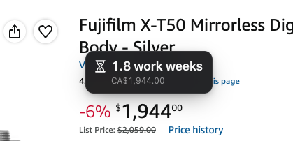

# Worth It?

A Chrome extension that shows prices in hours of your work. Hover any price to see what it costs you, like **8.3 hours**, or turn on small badges next to every price.



Your pay stays on your device. Websites can't read it, and nothing is sent anywhere unless you turn on exchange-rate syncing.

## Install

**From a release (no build needed)**

1. Download `worth-it.zip` from the [latest release](https://github.com/nathanielfernandes/worth-it/releases/latest) and unzip it.
2. Open `chrome://extensions` and turn on **Developer mode** (top right).
3. Click **Load unpacked** and select the unzipped folder.
4. Enter your pay on the welcome page, then reload any open store tabs.

**From source** (needs [Bun](https://bun.sh))

```sh
git clone https://github.com/nathanielfernandes/worth-it
cd worth-it
bun install
bun run build
```

Then follow steps 2–4 above, selecting the `dist/` folder.

## Use

- **Hover a price** to see how long you'd work for it.
- **Popup:** set your pay (hourly, weekly, every two weeks, monthly, yearly, or an average of recent paychecks), before or after tax, and your hours.
- **Badges:** turn on "Show badges next to prices" in the popup.
- **Other currencies:** enter rates by hand, or opt in to daily rates from [frankfurter.dev](https://frankfurter.dev) (only your currency code is sent).
- **Alt+Shift+W** pauses the extension on the current site.

## Develop

| Command | What it does |
|---|---|
| `bun run watch` | rebuild on change (then click reload in `chrome://extensions`) |
| `bun run typecheck` | run TypeScript |
| `bun run package` | build and zip `dist/` into `worth-it.zip` |
